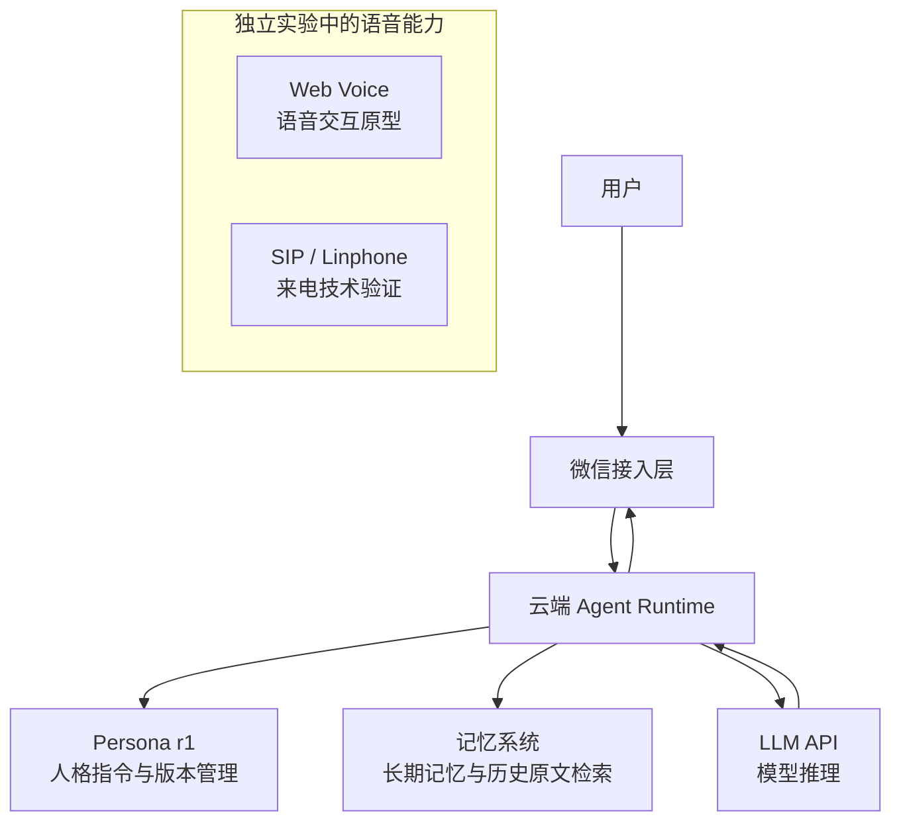

# PP Phone｜个性化 AI 陪伴 Agent

### 一个拥有长期记忆与连续人格的个性化 AI 陪伴 Agent

PP Phone 是一个持续迭代的个人 AI Agent 项目，致力于探索：**如何让 AI 不只是完成单次对话，而是能够记住共同经历、保持稳定人格，并在不同交互场景中延续关系。**

项目围绕三个核心问题展开：

- **人格一致性**：如何让 AI 在长期互动中保持自然、稳定、有独立判断的表达方式？
- **长期记忆**：如何通过原文留存、来源追溯与记忆检索，实现跨会话的连续性？
- **多模态交互**：如何从文字聊天拓展到实时语音，让 AI 交互更加自然？

## 当前进展

| 模块 | 状态 |
|---|---|
| 微信聊天与云端 Agent Runtime | 已接入运行 |
| 人格指令版本管理 | r1 已部署 |
| 历史原文检索 | 已有真实微信单样例验证 |
| Web 实时语音 | 原型阶段，真实体验待完善 |
| SIP 语音来电 | 技术验证阶段 |

## 项目定位

这是一个结合 **AI 产品设计、LLM Agent 架构、长期记忆系统和语音交互技术** 的个人实践项目。

项目将持续记录产品设计思路、系统架构、技术实验、测试方法与迭代过程。

## 系统架构

PP Phone 采用云端统一 Agent Runtime 架构，将交互渠道、人格配置、长期记忆和模型推理解耦，以支持跨渠道的连续交互。

### 核心设计思路

- **统一运行时**：由云端 Agent Runtime 统一组织模型调用、人格配置与记忆检索。
- **人格与模型解耦**：Persona 独立管理并支持版本回退，不依赖特定 API 账号。
- **可追溯记忆**：区分近期上下文、长期记忆与带出处的历史原文，降低错误记忆风险。
- **渠道扩展**：以微信文字交互为当前运行入口，Web Voice 与 SIP 通话能力处于独立实验阶段。

> 架构图为公开简化版本，不包含私人数据、生产地址或服务凭据。语音实验模块不代表完整 AI 通话功能已经正式上线。

> 本仓库为公开展示版本。真实对话、私人记忆、API 凭据及生产环境配置不对外公开。
